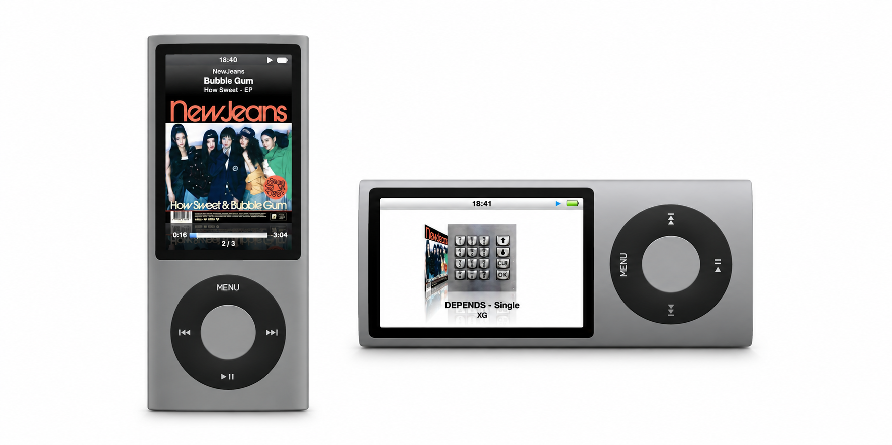

# NanoDesk

[English](README.md) · 日本語 · [한국어](README.ko.md)



NanoDeskは、シルバーの第5世代iPod nanoを操作できる3DモデルとしてMacのデスクトップに表示するアプリです。日本語の画面でMusic.appの曲を再生し、Cover Flowでアルバムを探したり、Macのカメラで動画を撮影したりできます。

## Macにインストール

macOS 15以降を搭載したApple Silicon Mac、Git、Xcode 16以降が必要です。Xcodeをインストールし、一度開いて初期設定を済ませてください。

```bash
git clone https://github.com/okuda1506/nanodesk.git
cd nanodesk
./scripts/install-macos.sh
```

スクリプトがRelease版をビルドしてローカル署名し、`~/Applications/NanoDesk.app` に配置して起動します。次回からは、Finderでホームフォルダの「アプリケーション」を開き、**NanoDesk** をダブルクリックします。アプリの操作はメニューバーの **NanoDesk** から行えます。更新するときはNanoDeskを終了し、既存のアプリを別の場所へ移動してから、更新済みのリポジトリでスクリプトを再実行してください。

## 基本操作

| 操作 | 方法 |
|---|---|
| メニューを選ぶ | クリックホイールをなぞってスクロールし、中央をクリックして決定します。**MENU** で戻ります。 |
| 回転・移動 | 筐体をドラッグして回転し、Optionを押しながらドラッグして移動します。筐体をダブルクリックするか **Reset Orientation** で正面に戻ります。 |
| 拡大・縮小 | ピンチ、Command＋スクロール、または **Increase Size**、**Decrease Size**、**Reset Size** を使います。 |
| 表示の管理 | メニューバーから表示・非表示、位置リセット、**Always on Top**、**Click Through**、終了を操作できます。本体を操作するときは **Click Through** を解除します。 |
| ホールド | 本体を回して上端のホールドスイッチをクリックします。オレンジの印が出ている間はホイール操作と回転によるCover Flowの切り替えが無効になります。再生中の曲は流れ続けます。もう一度クリックすると解除できます。 |

## 音楽を再生する

iTunes Storeで購入した曲は、MacのMusic.appのライブラリに追加されると、NanoDeskのiPodの **曲** 一覧にも表示されます。購入後に **曲** を開き直すと、新しく追加された曲を確認できます。

**ミュージック → 曲** を開き、macOSの確認画面でNanoDeskによるMusicの操作を許可します。Music.appのライブラリから再生できる曲を選び、中央を押すと **再生中** 画面が開きます。再生中の曲を選んだ場合は、その位置から表示します。左・右・下のホイールボタンで前の曲・次の曲・再生／一時停止を操作でき、一覧画面でも使えます。許可しなかった場合は **システム設定 → プライバシーとセキュリティ → オートメーション → NanoDesk** でMusicを有効にし、**曲** を開き直してください。

## Cover Flowでアルバムを探す

ホーム、ミュージック、曲一覧、再生中画面で、2本指のひねり操作かCommand＋ドラッグで本体を横向きにします。**ミュージック → Cover Flow** からも開けます。ホイールを回すとアーティスト順にアルバムを確認でき、速く動かすと頭文字で移動できます。中央でアルバムを開き、曲を選んで再度中央を押すと再生します。本体を縦向きにすると戻ります。

## 動画を撮影する

ホームで **ビデオカメラ** を選び、カメラへのアクセスを許可します。音声を録音するにはマイクも許可します。中央を押すと録画が始まり、赤い印とタイマーが表示されます。もう一度中央を押すと停止して保存します。**MENU** でホームに戻る際も、録画中の動画は保存処理に入ります。

メニューバーの **Open Camera Roll in Finder** から「ムービー」内の **NanoDesk/Camera Roll** を開けます。保存形式は640 × 480、30 fpsを目標とするH.264 MP4で、マイクが使える場合はAAC音声が付きます。縦長のプレビューは左右反転し、保存動画は横長で左右反転しません。

NanoDeskはAppleの公認を受けていないファンプロジェクトです。
