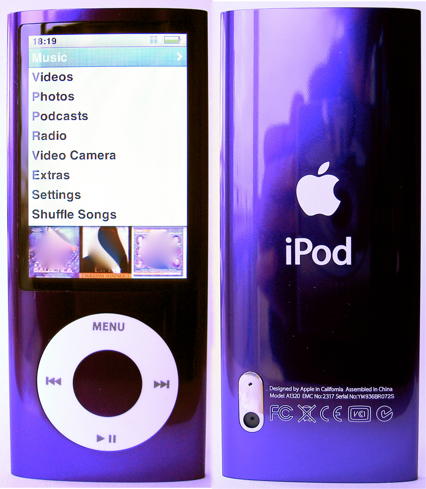
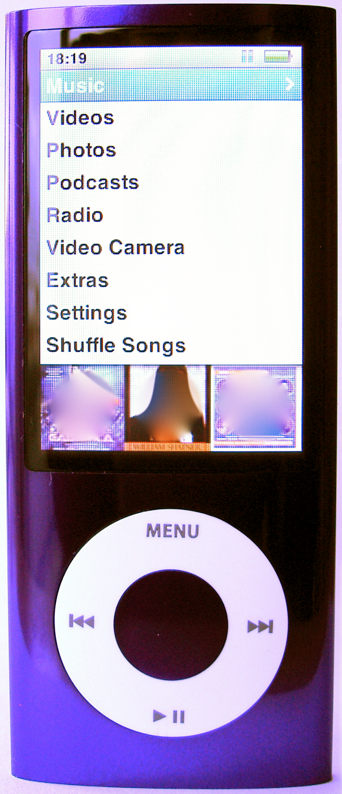
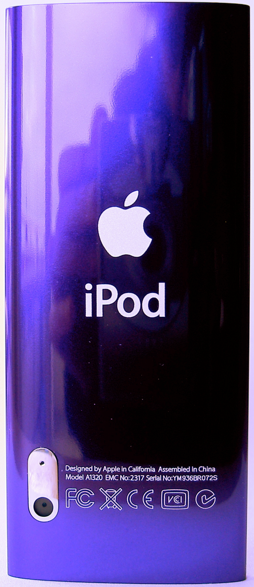
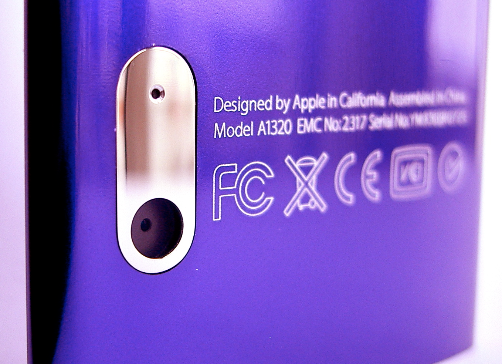

# iPod nano (5th Generation) — 3D Modeling References

This is the **reference pack for Phase 1** of NanoDesk. Use it with [SPEC.md](SPEC.md) and the machine-readable [dimensions JSON](../assets/references/ipod_nano_5g_dimensions.json).

> **Local photo sources now available (2026-11-21):** Four reference PNGs are committed in [`assets/references/photos/`](../assets/references/photos/README.md). These local files replace fragile external image embeds for Codex Cloud (which previously encountered HTTP 403). Codex must open and inspect the actual pixels. **Figure 16-64 remains an external-only drawing**; until it is genuinely inspected, engineering-drawing callouts are unverified. See [reference recovery instructions](REFERENCE_ACCESS.md).

**Device:** Apple iPod nano (5th generation), model A1320, introduced in September 2009. Do **not** accidentally model the 4th-generation nano (A1285); the camera, screen, finish, and click-wheel dimensions differ.

## 1. Reference photographs

The photographs below are **local, repository-hosted copies** of user-supplied Wikimedia Commons references. Each entry retains its original source page, author, and CC BY-SA 3.0 license. These copies show a **purple** device; use them to model geometry while keeping NanoDesk's default **silver** finish. The source links document provenance and license terms.

### Front and back — primary silhouette reference

- **Source:** [Lubyanka, *iPod Nano 5th generation purple front and back*, Wikimedia Commons](https://commons.wikimedia.org/wiki/File:IPod-Nano-5G-front-back.png)
- **License:** [CC BY-SA 3.0](https://creativecommons.org/licenses/by-sa/3.0/) — photo by **Lubyanka**, provided as a local modeling reference with attribution to Wikimedia Commons.
- **Use for:** Outer contour, screen and wheel vertical alignment, camera placement, rounded lower edge, rear shell, and color/reflection differences.
- **Important:** The reference is **purple**. NanoDesk's default device color in the specification is **silver**. Use the photo for geometry, not for the final material base color.
- **Important:** This composite is **not a metrically calibrated orthographic plate**. Lens perspective, crop, and alignment can distort measurements.

### Front — proportions and control placement

- **Source:** [Lubyanka, *iPod Nano 5th generation purple front*, Wikimedia Commons](https://commons.wikimedia.org/wiki/File:IPod-Nano-5G-front.png)
- **License:** [CC BY-SA 3.0](https://creativecommons.org/licenses/by-sa/3.0/). Photo by **Lubyanka**; provided as a local reference copy.
- **Use for:** Screen aperture, wheel ring, centered Select button, labels and button layout, top/bottom body margins.

### Back — rear geometry and video camera

- **Source:** [Lubyanka, *iPod Nano 5th generation purple back*, Wikimedia Commons](https://commons.wikimedia.org/wiki/File:IPod-Nano-5G-back.png)
- **License:** [CC BY-SA 3.0](https://creativecommons.org/licenses/by-sa/3.0/). Photo by **Lubyanka**; provided as a local reference copy.
- **Use for:** Rear convex/reflective finish, camera and microphone placement, back surface proportions.
- **IP note:** Apple logo/wordmarks visible in some original photographs are trademarks. Reference photos do not grant permission to reproduce logos in a distributed app.

### Rear video camera / microphone close-up

- **Source:** [Lubyanka, *Photograph of the camera, microphone and speaker detail*, Wikimedia Commons](https://commons.wikimedia.org/wiki/File:IPod-nano-5G-camera-view-1.png)
- **License:** [CC BY-SA 3.0](https://creativecommons.org/licenses/by-sa/3.0/). Photo by **Lubyanka**; unmodified remote reference.
- **Use for:** Rear camera lens/bezel, nearby small microphone aperture, polished highlights and small cut-outs.

### Top, bottom and side detail (linked source images)

- [Top and bottom end views — Wikimedia Commons](https://commons.wikimedia.org/wiki/File:IPod-Nano-5G-ends.png)
- [Additional end views — Wikimedia Commons](https://commons.wikimedia.org/wiki/File:IPod-nano-5G-end-views-1.png)
- [Photos and illustrations of the 5th generation — Wikimedia Commons category](https://commons.wikimedia.org/wiki/Category:IPod_nano_(5th_generation))
- [A CC0 close-up of the 5th-generation click wheel — Expert-Apple](https://commons.wikimedia.org/wiki/File:IPod_Nano_5th.jpg), **CC0 1.0**.

Confirm the license on each individual source page **before downloading or redistributing** any additional image. Do not silently substitute different iPod generations.

### Official product/color reference

- [Apple: identify iPod nano models](https://support.apple.com/en-us/103823)
- [Apple: fifth-generation iPod nano user guide](https://cdsassets.apple.com/live/6GJYWVAV/user/ma1194_ipod_nano_5th_gen_userguide.pdf)
- [Apple: 2009 nano environmental report with silver product image](https://www.apple.com/th/environment/pdf/products/archive/2009/iPod_nano_Environmental_Report.pdf)

Apple product images and diagrams are **reference links only**; do not copy them into Git or bake them into the shipped app without a rights review.

## 2. Physical dimensions and specifications

**Values from the Apple-published technical specification** (dimensions are for the physical device, not the UI view size):

| Property | Value | Confidence / source |
|---|---:|---|
| Height | **90.7 mm** | Official product specification |
| Width | **38.7 mm** | Official product specification |
| Depth (maximum quoted) | **6.2 mm** | Official product specification |
| Weight | **36.4 g** | Official product specification |
| Display diagonal | **2.2 in** | Official product specification |
| Display pixels | **240 x 376** | Official product specification |
| Display pixel density | **204 ppi** | Official product specification |
| Camera recording | **640 x 480 (VGA), up to 30 fps, H.264 + AAC** | Official product specification |

**Original-spec source:** [Apple's archived fifth-generation technical specifications (PDF mirror)](https://docs.rs-online.com/03a5/0900766b80d8017c.pdf), page 1.

### Engineering drawing — dimensions of smaller details

Apple's *Accessory Design Guidelines for Apple Devices*, section **16.59, Figure 16-64, "iPod nano (5th generation) Dimensional Drawing"**, contains mechanical multi-view diagrams.

- [Engineering drawing reference PDF (Apple material hosted by manuals.plus)](https://manuals.plus/m/86b9af196de65a103ec1095ad3421c275dc60bb1cacb7ce71b7ac7bedb7322e7.pdf)
- Locate **section 16.59**, printed page **157**, figure **16-64**. Do not use the neighboring 4th-generation sheet.
- Visible drawing annotations include **click-wheel outer diameter Ø27.1 mm** and **center button diameter Ø13.2 mm**. These are **engineering-drawing values** (not separately corroborated in the product specification), and must be checked against the source drawing before final CAD modeling.
- Other callouts concern screen offsets, edge distances, ports, and body curves. **Do not assign a callout to a named feature unless the arrow/leader was actually inspected.**
- Do not commit an Apple-authored PDF or a crop of its dimensional drawing. Link to the external source.

### Dimensions we have not established

Exact positions of the screen, wheel center, camera lens center, top Hold switch, 30-pin dock connector cut-out, side curvature radius, and surface-layer depths are **not yet validated** as numeric CAD coordinates. They must remain **unknown/TBD**, not invented numbers. Prefer reading the original engineering drawing and measuring a physical device; photographs are secondary evidence.

## 3. Model creation and verification workflow

1. **Base dimensions:** Set the Blender scene to millimeters; constrain the full outer bounding box to 38.7 x 90.7 x 6.2 mm (width x height x depth).
2. **Blockout first:** Create front/side/back shell profiles, screen placeholder, wheel outer ring and center button. Keep named separate objects for screen, wheel, directional hit areas, rear camera, and housing.
3. **Engineering drawing:** Read section 16.59 and verify control diameters and exact feature positions. Update the JSON with proven dimension callouts and source notes. Never infer millimeters solely from perspective photographs.
4. **Photo comparisons:** Render front, rear, left/right sides, top/bottom, and 45-degree views with a near-orthographic camera. Compare silhouettes and locations to the reference photos, allowing for photo perspective and color differences.
5. **Materials:** Aim for the specified **silver** polished aluminum finish, black bezel and dark click-wheel ring. Model plausible smooth edge reflections instead of a flat extrusion.
6. **Visual review:** Put renders in a PR for review before investing in advanced UI or exporting final USDZ.
7. **Runtime export:** Keep the editable .blend source (and reproducible generator if applicable), create USDZ for RealityKit, and validate rendering/materials on a real Mac.

### Quality checklist

- [ ] Dimensioned outer body matches 90.7 x 38.7 x 6.2 mm.
- [ ] Fifth-generation proportions and 2.2-inch display reference are used.
- [ ] Front and back genuinely differ; rear camera detail is present.
- [ ] Screen, wheel ring, Select and other input targets are distinct.
- [ ] Wheel Ø27.1 / center Ø13.2 values are cross-checked with the Apple drawing.
- [ ] Top/bottom ports and Hold switch are visible in appropriate views.
- [ ] Silver material and lighting do not flatten the shell's shape.
- [ ] The model can rotate cleanly through 360 degrees without missing surfaces.
- [ ] Reference image attribution and license metadata remain attached.
- [ ] Geometry, textures, screenshots and any distributed assets are reviewed for trademark and copyright issues.

## 4. Public repository image policy

- **Current strategy:** keep four reference photographs locally in `assets/references/photos/` with explicit creator, source URL, and CC BY-SA 3.0 license attribution. Their availability no longer depends on Codex Cloud being able to fetch the external photo hosts.
- These photographs may be licensed for reuse, but their **photograph copyright** and the **depicted Apple trademarks/product design** are separate questions.
- If any additional images are copied into Git, preserve author/source/license notices and modification history; comply with CC BY-SA requirements where applicable.
- Do not add photos from random product listings, news articles, or search thumbnails without verifying re-use rights.
- Do not treat photo textures, Apple firmware graphics, or Apple logos as freely reusable runtime app assets.

---

_Last researched: 2026-11-21. Validate references and measurements before finalizing the high-fidelity 3D model._
