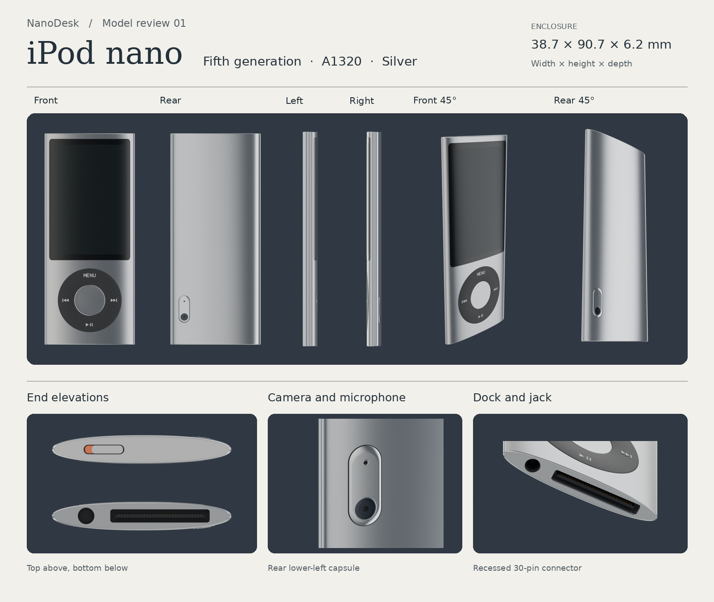
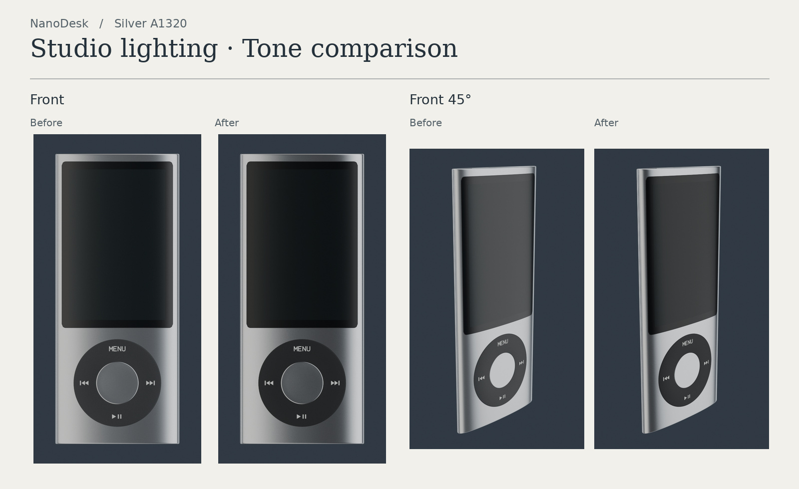
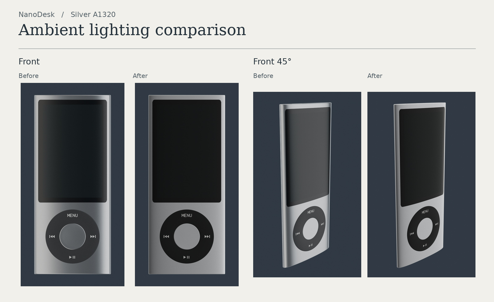
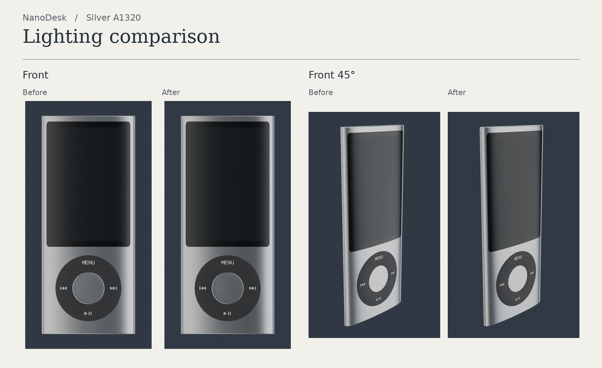

# A1320 · Silver model review 01



[Editable Blender master](../assets/source/ipod_nano_5g.blend) · [Review USDZ](../assets/runtime/NanoModel.usdz) · [Geometry generator](../assets/scripts/generate_model.py)

## Inspect the renders

The first six views use orthographic projection. The two 45° views use a perspective lens with opposite elevations so the upper and lower shoulders are visible.

| Face | Edge | End | Perspective | Detail |
|---|---|---|---|---|
| [Front](../assets/renders/front.png) | [Left](../assets/renders/left.png) | [Top](../assets/renders/top.png) | [Front 45°](../assets/renders/front_45.png) | [Lens and microphone](../assets/renders/camera_detail.png) |
| [Back](../assets/renders/back.png) | [Right](../assets/renders/right.png) | [Bottom](../assets/renders/bottom.png) | [Rear 45°](../assets/renders/back_45.png) | [Dock and jack](../assets/renders/dock_detail.png) |

## Studio lighting tone comparison



| View | Before | Adjusted tone |
|---|---|---|
| Front | [Studio render](../assets/renders/lighting_review/front.png) | [Tone adjusted](../assets/renders/tone_review/front.png) |
| Front 45° | [Studio render](../assets/renders/lighting_review/front_45.png) | [Tone adjusted](../assets/renders/tone_review/front_45.png) |

This pass starts from the Before images in the ambient lighting comparison. A luminance curve deepens the screen and wheel tones. The bright silver reflections, camera backdrop, and framing come directly from the studio renders. Generate both PNGs and the comparison sheet from those sources with Pillow and NumPy.

```bash
python3 assets/scripts/review_sheet.py --tone-review
```

## Ambient lighting comparison



| View | Previous lighting | Ambient lighting |
|---|---|---|
| Front | [Before](../assets/renders/lighting_review/front.png) | [After](../assets/renders/ambient_review/front.png) |
| Front 45° | [Before](../assets/renders/lighting_review/front_45.png) | [After](../assets/renders/ambient_review/front_45.png) |

This comparison uses a smooth ambient gradient for the metal's curved shading. The reflection panels are absent. Standard color management and a low-tone curve give the screen and click wheel deeper blacks against the silver. The camera framing, device geometry and material values match the earlier renders.

```bash
blender -b -t 4 --python-exit-code 1 -P assets/scripts/generate_model.py -- --ambient-review
python3 assets/scripts/review_sheet.py --ambient-review
```

## Previous lighting comparison



| View | Original | Adjusted |
|---|---|---|
| Front | [Before](../assets/renders/front.png) | [After](../assets/renders/lighting_review/front.png) |
| Front 45° | [Before](../assets/renders/front_45.png) | [After](../assets/renders/lighting_review/front_45.png) |

The adjusted render softens the vertical reflection panels and uses a gentle RGB curve under AgX to separate aluminum midtones. The same camera framing, mesh, and materials make the changes directly visible. From the front, the vertical streaks draw less attention and the metal below the wheel shows a slightly stronger gradient. At 45°, the shadow next to the rim gives the curve more depth, and the reflected edge and glass boundary are still visible. The aluminum reads closer to the requested natural silver finish in this comparison. The available device photos show a purple unit, so this is a visual judgment rather than a match against a measured silver sample.

As a check, the front image's 95th percentile luma in the left and right rim strips dropped from 190 to 187 and 202 to 200 on an 8-bit scale. The 5th-to-95th percentile luma spread in the aluminum band below the wheel grew from 95 to 98. The central glass sample retained detail and had zero pixels at black in both images.

Generate the two adjusted renders and the comparison sheet with the commands below. The adjusted outputs are saved in `assets/renders/lighting_review/`.

```bash
blender -b -t 4 --python-exit-code 1 -P assets/scripts/generate_model.py -- --lighting-review
python3 assets/scripts/review_sheet.py --lighting-review
```

## Shape evidence

**VERIFIED_REFERENCE** — All four original PNGs in the [local photo set](../assets/references/photos/README.md) were opened. The composite establishes front/rear orientation. The individual front view shows a narrow metal band above the rounded black bezel, a larger gap below the bezel, a concentric wheel and a center key in the body finish. The rear view shows a continuous longitudinal highlight around the side and a narrow vertical capsule low on the viewer's left. The close-up resolves a small dark mic opening above a much larger dark lens, a bright surround and a fine perimeter joint. The rear photograph carries the A1320 model marking.

The figures below are approximate pixel readings from the original, unrectified front (819 × 1896 px) and rear (824 × 1896 px) photos. Published dimensions take precedence over photographic ratios. Outer boundaries vary slightly across each photograph.

| Landmark | Source and observation | Geometry in this revision |
|---|---|---|
| Outer envelope | Product dimensions in the repository | 38.7 mm wide × 90.7 mm high × 6.2 mm deep. Bounding box includes the end fittings. |
| Active display | 2.2 in nominal diagonal and 240:376 portrait aspect. Photo shows a lit rectangle about 626 px wide; body about 790 px wide. | 30.065 × 47.102 mm projected aperture. Width ratio 77.7%, compared with approximately 79% in the photo. |
| Vertical display position | Active area about y=110…1078, body about y=8…1884. Midpoint about 31.2% down. | 28.4 mm from the top, or 31.3%. Cover is 34.55 × 51.85 mm with rounded corners. Position and cover dimensions are photo estimates. |
| Wheel and Select | About 560 and 275 px across at the wheel, about 71% and 35% of body width. Center at about y=1490, or 21% of height above the base. | 27.1 and 13.2 mm nominal diameters (70.0% and 34.1%). Wheel center is 19.05 mm above base (21.0%). |
| Rear capsule | About 100 × 240 px, or approximately 12.7% of body width and 12.8% of height. Lens center near (140,1635), mic near (137,1497). | Gasket is 4.94 × 11.82 mm (12.8%, 13.0%). Lens center is 11.9 mm above base, mic 18.6 mm; both are 5.95 mm in from the rear viewer's left edge. Photo estimates. |
| Side roll and end hardware | The front/rear reflections show a continuous roll. The four photos have no calibrated side or end view. | A smooth, hollow aluminum extrusion with a convex cross section, a returned lip at each end, a recessed hold track, an open jack bore and a dock cavity with a tongue and contact strips. Cross-section exponent, offsets, depths, connector layout and switch travel are modeling estimates. |

**BLOCKED_DIMENSIONAL_DRAWING** — Figure 16-64 was unavailable. The two wheel diameters are provisional transcriptions already present in the dimension data. The drawing leaders, end-port orientation, corner radii, wall thickness, lens protrusion and surface stack remain unverified. This asset is a visual reconstruction and has no manufacturing tolerances.

## Review changes and outstanding judgments

In the first studio pass, broad bright area lights obscured the bezel edge, the rear capsule and part of the silver side roll in the perspective views. A second pass used long reflection panels and dark gaps to reveal the crown of the extrusion. The revised studio angles the panels slightly, reduces the shell roughness, darkens the graphite wheel, and uses a smoother sampling pass. The bottom socket sleeves also face inward so their linings remain visible in single-sided runtime rendering.

The front display, wheel and rear camera landmarks read close to the photographed proportions. The orthographic profile and end views show where the depth goes: a crowned back, thin lateral edges and return lips surrounding separate inserts. Surface radii, end geometry and the silver finish still need physical reference. The photographs show a purple unit with a pale wheel; this revision follows the project's silver housing and dark ring finish. The polished center follows the housing finish. The off-state display makes the glass, bezel and UV-mapped surface visible without using firmware imagery.

Please review the screen margins and wheel contrast in the front view, the strength of the side highlight at 45°, and the lens/plate proportions in the close-up. A straight-on end photo of a silver A1320 would help settle the port layout and end-cap finish.

## Editable assembly and runtime handoff

All geometry is modeled in meters, calculated from millimeters. The Blender origin is the middle of the body, with +Z up and −Y toward the front. The continuous shell has named FrontHousing and RearHousing vertex groups. The runtime package contains the corresponding named face sets. The studio lives outside the device collection.

| Part | Structure |
|---|---|
| Body | Parent for the whole device. AluminumExtrusion carries the skin, return lips and inner wall. |
| ScreenBezel / ScreenSurface | Rounded black cover and separate curved display mesh. UVs span 0…1 from the front lower left. Replace ScreenSurface's material to show dynamic content. |
| WheelRing / CenterButton | The wheel parent contains four visible sector meshes named MenuButton, PreviousButton, NextButton and PlayPauseButton. The center key and printed vector legends are separate. |
| HoldSwitch / DockConnector / HeadphoneJack | Switch slider and indicator above a recessed track. The dock tongue, contacts, sleeve, headphone bore and inner lining are individually editable. |
| RearCamera / Microphone | Metal capsule with a separate retainer, optical window, pupil, mic rim and opening. |

The USDZ is a review build with Y up, +Z facing the viewer and meters per unit set to 1. Its default prim is Body. It contains the named device meshes, screen UVs, corner normals and USD Preview Surface materials. The studio and reference photos are excluded. On macOS, open the USDZ in Quick Look or Reality Composer Pro, inspect both sides of the port openings and check scale. For later RealityKit integration, load the root entity, resolve the sector meshes by name, and attach front-facing hit shapes. Assign an orientation-test texture to ScreenSurface before integrating a dynamic display. Glare, clearcoat and color depend on the runtime lighting.

**CLOUD_TESTED** — Reopening the Blender master confirmed the device collection, packed procedural studio and screen UV map. The generator checks all evaluated device vertex coordinates against the specified bounding box with a 0.01 mm tolerance. The model contains 60 mesh objects, 17,066 vertices and 31,293 triangles after polygon triangulation. Reopening the USDZ with OpenUSD confirmed the package, all 62 named objects (including two parents), material bindings, screen UVs, Y-up axis and 38.7 × 90.7 × 6.2 mm runtime bounds.

**BLOCKED_LOCAL_MAC** — On-device Quick Look and RealityKit material appearance, screen orientation in the app, selection and performance await Mac validation.

## Reproduce

Run from the checkout root with Blender 4.3.2 (Cycles CPU) and Python 3.12 with OpenUSD 26.11 for packaging. Blender writes the master and the ten PNGs. The optional exchange file stays outside the repository. The review sheet uses Pillow and DejaVu Sans/Serif (Debian font paths).

```bash
blender -b -t 4 --python-exit-code 1 -P assets/scripts/generate_model.py -- --exchange /tmp/nano-meshes.json
python3 assets/scripts/package_usdz.py /tmp/nano-meshes.json assets/runtime/NanoModel.usdz
python3 assets/scripts/review_sheet.py
```

For a quick iteration, append `-- --preview front back camera_detail` to the Blender script invocation in place of the exchange arguments. Preview PNGs go under the system temporary directory. The USDZ packager uses the OpenUSD Python bindings (`usd-core==26.11`, Tomorrow Open Source Technology License 1.0). Blender is GPL-licensed. Neither tool ships in the runtime asset.

Geometry, PBR materials, vector control legends and the studio environment are authored here. The local Wikimedia photos remain separately attributed to Lubyanka under CC BY-SA 3.0. The model uses no photo textures, Apple logo, serial markings, or firmware UI. Public distribution of a reconstruction of Apple's product design still merits a rights review.
